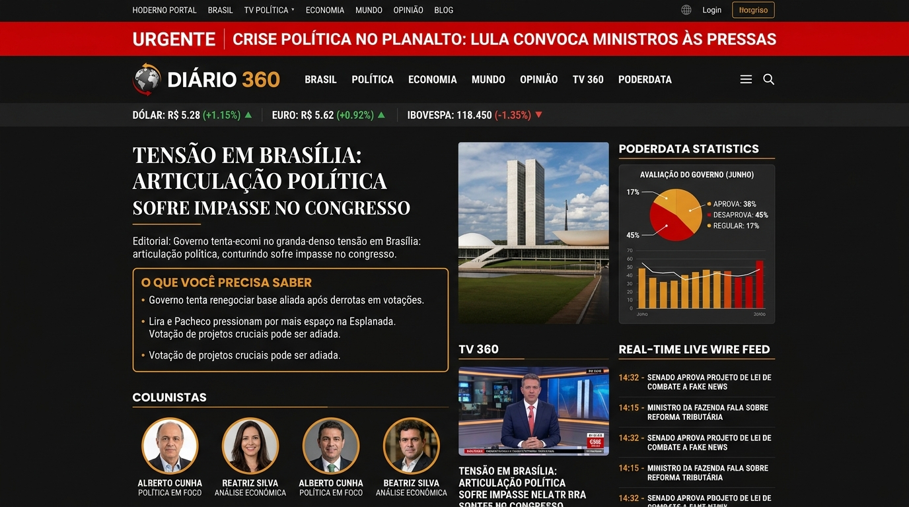
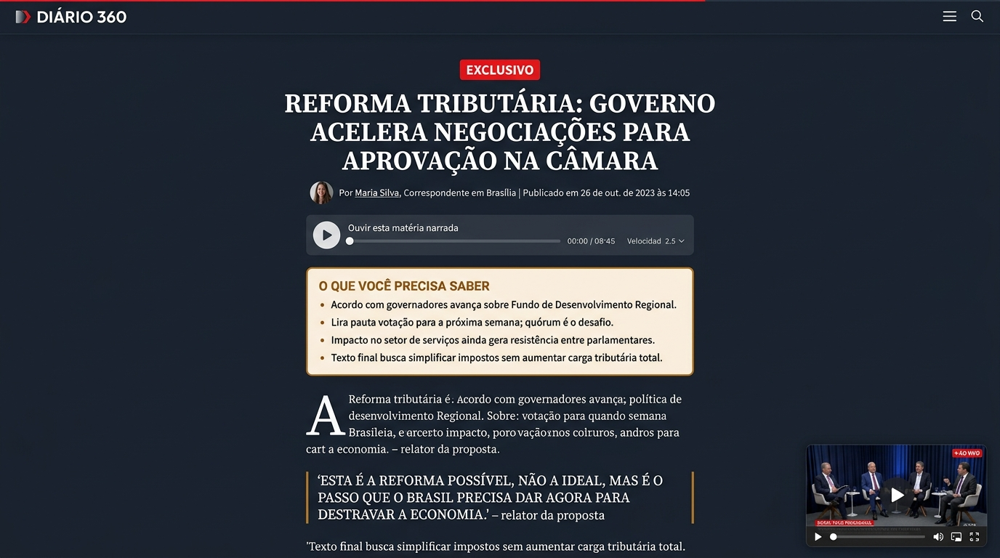

# 📰 DIÁRIO 360 — Modelo de Jornal Digital Moderno

> **Portal de Notícias Editorial de Alta Performance** inspirado na cobertura multimídia e ao vivo da **CNN Brasil** e na agilidade analítica orientada a dados do **Poder360**.



---

## 🎯 Sobre o Projeto

O **Diário 360** é um modelo (*template/boilerplate*) completo e responsivo de portal de notícias voltado para política, economia, negócios e cobertura de bastidores dos Três Poderes em Brasília.

Ele une duas das linguagens editoriais mais consolidadas do jornalismo digital brasileiro:
1. **O Modelo CNN:** Tarja animada de *Breaking News*, cobertura minuto a minuto em tempo real (*liveblogging*), sinal de transmissão ao vivo com Picture-in-Picture e foco multimídia (TV e podcasts).
2. **O Modelo Poder360:** Super manchete acompanhada do bloco **"O que você precisa saber"** (resumo executivo em tópicos antes do texto), painel de estatísticas com pesquisas de opinião (**PoderData**) com múltiplos gráficos exportáveis, e cotações de mercado com mini-gráficos (*sparklines*).

---

## ✨ Funcionalidades Principais

### 1. 📈 Terminal Financeiro & Clima (Topo)
* Cotações em tempo real de **Dólar, Euro, Ibovespa, Bitcoin, Taxa Selic e IPCA**.
* **Mini-gráficos intradia vetoriais (*Sparklines* SVG)** com trajetórias em verde (alta) e vermelho (baixa).
* Widget de clima com temperatura e previsão de Brasília.
* Flutuação randômica realista dos ativos a cada 8 segundos.

### 2. 🚨 Tarja de Urgência (*Breaking News* - CNN)
* Indicador pulsante em vermelho intenso para notícias de última hora.
* Botão com radar de ondas sonoras para o **Sinal Ao Vivo** da TV 360.
* Acesso rápido direto para a cobertura detalhada do fato.

### 3. 📑 Super Manchete & Selos Editoriais
* Destaque com fotografia cinematográfica e metadados completos.
* Selos de escopo: `EXCLUSIVO`, `BASTIDORES`, `ANÁLISE`, `URGENTE`.
* Bloco **"O QUE VOCÊ PRECISA SABER"**: 3 a 5 tópicos diretos para tomadores de decisão lerem antes do artigo completo.

### 4. 📊 Painel PoderData (Pesquisas & Estatísticas)
* Gráficos interativos em HTML5 Canvas de alta resolução com 3 modos de visualização:
  * **Linhas:** Curva histórica das pesquisas de aprovação e expectativas de inflação.
  * **Donut (Circular):** Gráfico de rosca focado no levantamento mais recente com legenda.
  * **Barras:** Comparativo mensal dos índices.
* **Exportação para Redes Sociais:** Botão **"Baixar Gráfico (PNG)"** que gera instantaneamente uma imagem formatada com a marca d'água oficial do jornal para postar no WhatsApp, LinkedIn ou X.

### 5. ⏱ Feed "Minuto a Minuto" (Wire)
* Linha do tempo vertical com atualizações rápidas dos Três Poderes.
* Filtros dinâmicos por categoria: `Todos`, `Congresso`, `Economia` e `Judiciário`.
* Simulação de novas notas apuradas entrando a cada 25 segundos com animação de flash e aviso toast.

### 6. 📺 TV 360 & Picture-in-Picture (PiP)
* Seção de vídeo com player estilizado e playlist de programas/entrevistas.
* **Mini-Player Flutuante:** Ao rolar a página para baixo além do bloco de vídeos, um mini player desacopla no canto inferior direito para o usuário continuar assistindo enquanto lê a capa.

### 7. 📖 Página de Leitura do Artigo Imersiva

* **Barra de Progresso de Leitura:** Fita degradê fixa no topo acompanhando o scroll de 0% a 100%.
* **Ferramentas de Acessibilidade:** Ajuste de tamanho de fonte (`A-`, `A`, `A+`) e botão de impressão limpa.
* **Letra Capitular (*Drop Cap*):** Primeira letra do parágrafo inicial estilizada em destaque clássico.
* **Player "Ouvir Matéria":** Simulação de narração por voz de IA (*Text-to-Speech*) com barra de progresso.
* **Botões de Compartilhamento Direto:** WhatsApp, X (Twitter), LinkedIn e Cópia de Link.
* **Download de Documento Oficial:** Embed estilizado para download do PDF original (leis, sentenças, pareceres).

### 8. ✍️ Painel da Redação Embutido (CMS)
* Botão **"Área da Redação"** no topo da tela.
* Formulário para cadastrar manchete, linha fina, editoria, selo editorial, tópicos do resumo executivo e foto.
* Publicação instantânea na capa com persistência local em `localStorage`.

### 9. 🌓 Modo Escuro & Claro
* Alternador de tema no topo com persistência das preferências do usuário.
* Paleta nobre com excelente contraste e legibilidade editorial.

---

## 🛠️ Tecnologias Utilizadas

* **HTML5 Semântico:** Marcação estruturada para SEO e conformidade com Schema.org para agregadores de notícias.
* **CSS3 Moderno:** Design System com CSS Custom Properties (variáveis), CSS Grid, Flexbox e animações fluidas.
* **JavaScript Puro (ES6+):** Zero dependências externas pesadas (sem React, Vue ou Angular obrigatórios, carregamento instantâneo).
* **Fontes:** Google Fonts (*Outfit* para títulos e marcas, *Inter* para interface/cotações, *Merriweather* para leitura longa).
* **Ícones:** Font Awesome 6.5.

---

## 🚀 Como Executar Localmente

### Opção 1: Qualquer Servidor Local
Clone o repositório e abra com seu servidor de preferência:

```bash
# Clone o repositório
git clone https://github.com/dyegosan14-tech/diario360-jornal-digital.git

# Acesse o diretório
cd diario360-jornal-digital

# Executar com Python (disponível em quase todo sistema)
python -m http.server 8080

# Ou executar com Node (npx serve)
npx serve .
```

Abra seu navegador em: **`http://localhost:8080`**

### Opção 2: Abrir Diretamente no Navegador
Basta dar um duplo clique no arquivo `index.html`.

---

## 📁 Estrutura de Arquivos

```
diario360-jornal-digital/
├── index.html       # Estrutura HTML5 da Home, Leitor de Artigo, Modais e CMS
├── styles.css       # Design System completo, temas claro/escuro e responsividade
├── app.js           # Lógica do app: gráficos Canvas, cotações, busca, PiP e CMS
├── assets/          # Imagens de demonstração e capturas de tela do portal
├── README.md        # Documentação detalhada do projeto
└── LICENSE          # Licença MIT
```

---

## 📄 Licença

Este projeto está sob a licença **MIT** — sinta-se livre para usar, estudar, modificar e adaptar para seus próprios portais ou projetos comerciais.

Criado com foco em jornalismo moderno, dados e transparência.
